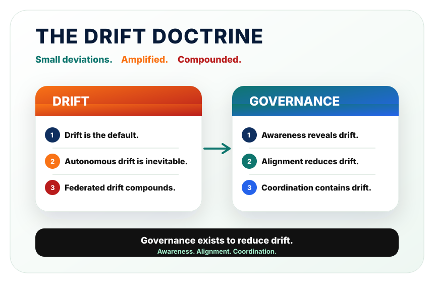
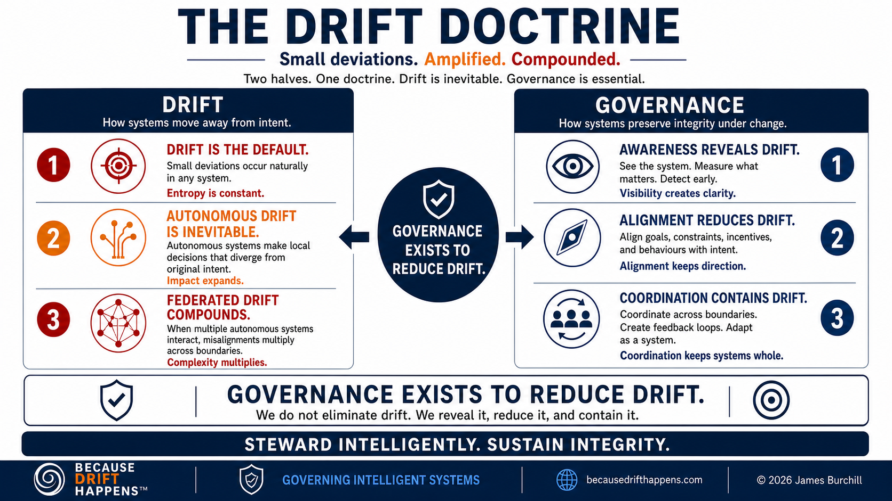

<section class="bdh-hero" markdown>

# Because Drift Happens™

Ideas on how systems change over time and stay aligned with their purpose.

Plans, processes, and software change over time. Small exceptions accumulate, assumptions become outdated, and what happens in practice can move away from what was intended. Because Drift Happens explores how we notice those changes and decide what to do next.

The Drift Doctrine applies across businesses, teams, processes, and technology. Its technical framework develops these ideas for intelligent and autonomous systems. Both explore how to keep changing systems understandable, accountable, and open to intervention.

[Read the doctrine](doctrine.md){ .bdh-button .bdh-button--primary }
[Choose a reading path](reading-map.md){ .bdh-button .bdh-button--secondary }

<figure class="bdh-visual" markdown>

</figure>
</section>

Autonomous systems do not remove drift. They make drift operationally consequential. The question is whether a running system can remain understandable, bounded, auditable, and open to intervention while it adapts.

## Doctrine At A Glance

<section class="bdh-doctrine-preview" markdown>

The Drift Doctrine describes two halves of the same operating reality: drift is inevitable, and governance is essential.

</section>

## Choose Your Reading Path

- [Business and organizational drift](reading-map.md#business-and-organizational-drift): start with commitments, changing assumptions, and the gap between a plan and what happens.
- [Technical systems and AI governance](reading-map.md#technical-systems-and-ai-governance): explore authority, observability, control planes, and intervention.

The six-line doctrine is the stable reference within this evolving framework. Concept pages are working interpretations, examples are illustrative, and planned work is labelled separately. [How to read the maturity labels](reading-map.md#content-maturity).

## Start Here

[**Doctrine** 
The canonical Drift Doctrine.](doctrine.md){ .bdh-link-card }

[**Manifesto** 
The core architectural position behind the framework.](manifesto.md){ .bdh-link-card }

[**Principles**  
The operating assumptions for governable intelligent systems.](principles.md){ .bdh-link-card }

[**Reading Map**  
Business and technical paths through the doctrine.](reading-map.md){ .bdh-link-card }

[**Glossary**  
The initial shared vocabulary.](glossary.md){ .bdh-link-card }

[**Failure Patterns**  
Recurring ways autonomous systems lose coherence.](failure-patterns.md){ .bdh-link-card }

[**Architecture Patterns**  
Control-plane and governance patterns for system design.](architecture-patterns.md){ .bdh-link-card }

## The Technical Framework

<ul class="bdh-compact-list">
  <li><a href="drift/">Drift</a></li>
  <li><a href="coherence/">Coherence</a></li>
  <li><a href="governance/">Governance</a></li>
  <li><a href="federation/">Federation</a></li>
  <li><a href="control-planes/">Control planes</a></li>
  <li><a href="intervention/">Intervention</a></li>
  <li><a href="observability/">Observability</a></li>
  <li><a href="examples/">Examples</a></li>
</ul>

## The Author and Related Work

Because Drift Happens is developed by [James Burchill](https://jamesburchill.com/), Business Systems Architect, CTO, and bestselling author. It brings together his thinking on how systems change and stay aligned with their purpose.

- [The Vault](https://vault.jamesburchill.com/) brings together practical knowledge, essays, field notes, and resources across business and technology.
- [Governing Intelligent Systems](https://vault.jamesburchill.com/governing-intelligent-systems/) is the Vault’s technical reading guide, connecting the framework to essays and field notes.
- [Driftinel](https://driftinel.com/) is a managed service in development that applies these ideas to business monitoring, helping owners spot slipping commitments and emerging problems with supporting evidence. Purchasing is not yet open.
- [JamesBurchill.com](https://jamesburchill.com/) provides a short biography and contact details.

This is not a product repository, vendor framework, compliance checklist, or finished doctrine. It is a public working framework intended to become more precise as the language, patterns, and examples are tested against real operational systems.

